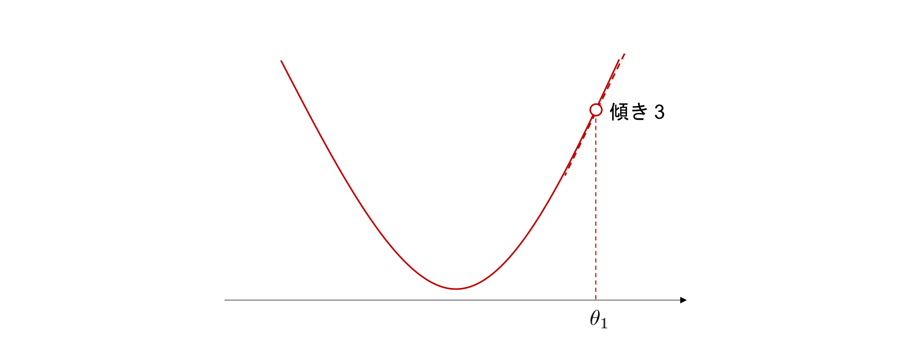
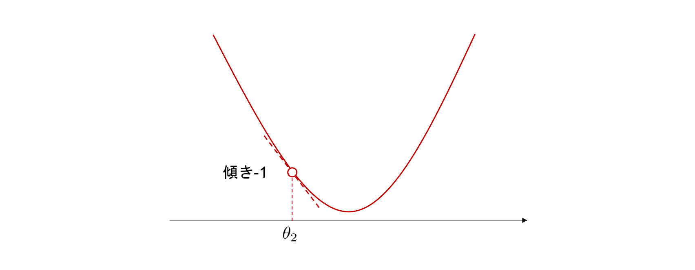
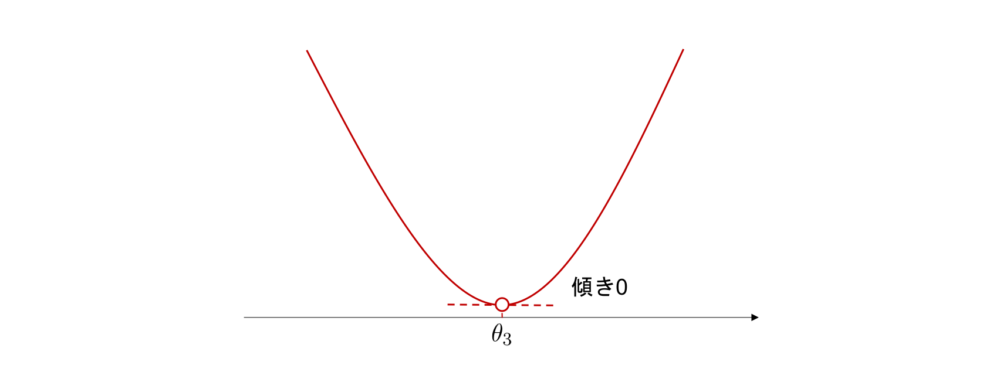
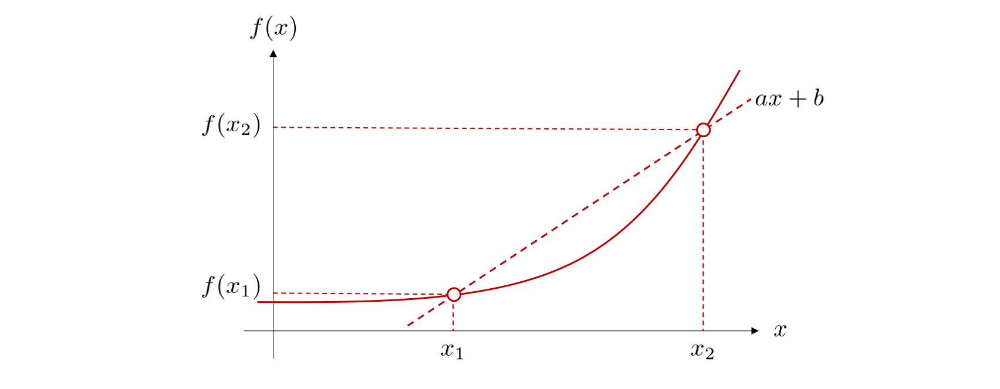
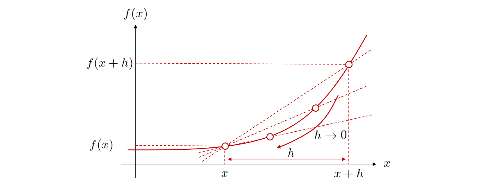

# 第04回 微分と積分

## この回の目標

微分・積分の意味を理解し，極値や微分・積分の値を数値計算で確認できる。

## 解説

この回では，第3回で扱った NumPy と Matplotlib を使い，微分と積分の値を数値計算で確かめる。
スクリプトの先頭には，第3回と同様に次の処理を書く。

```python
import numpy as np
import matplotlib.pyplot as plt
from pathlib import Path

figure_dir = Path("outputs/exc04")
figure_dir.mkdir(parents=True, exist_ok=True)
```

以下のコード例は，このコードに続けて書いて実行する。

### 1. 接線の傾きと関数の増減

#### 接線の傾きの符号

機械学習では，誤差を表す関数の値が最小になる入力を探す問題がよく現れる。
微分は，このような問題を解くための基本的な道具である。
例として，下図のような谷の形をしたグラフを持つ関数 $f(\theta)$ について，最小値をとる点を探すことを考える。



グラフ上のある点でグラフに接する直線を，その点における **接線 (tangent line)** という。
上図では，点 $\theta_1$ における接線（破線）の傾きは 3 であり，正である。
$\theta_1$ の近くでは，関数のグラフと接線はほとんど重なる。
このため，関数の値も接線と同じく，$\theta_1$ から右へ進むと増加し，左へ進むと減少する。



点 $\theta_2$ における接線の傾きは $-1$ であり，負である。
このため，$\theta_2$ の近くでは，関数の値は右へ進むと減少し，左へ進むと増加する。



最小値をとる点 $\theta_3$ では，接線は水平であり，傾きは 0 である。
以上をまとめると，接線の傾きと関数の増減には次の関係がある。

- 傾きが正の点の近くでは，関数は増加している。値を小さくするには左へ進めばよい。
- 傾きが負の点の近くでは，関数は減少している。値を小さくするには右へ進めばよい。
- 最小値をとる点では，傾きは 0 である。

谷の形をしたグラフでは，傾きが 0 になる点を探せば，最小値をとる点が分かる。
接線の傾きは，第2節で説明する微分を使って計算できる。
傾きを手がかりに，値が小さくなる向きへ少しずつ進んで最小値をとる点を探す方法は，第16回で扱う。

#### 極値

$x=a$ の近くの点とだけ比べて $f(a)$ が最も小さいとき，$f$ は $x=a$ で **極小 (local minimum)** になるといい，$f(a)$ を **極小値** という。
同様に，$x=a$ の近くの点とだけ比べて $f(a)$ が最も大きいとき，$f$ は $x=a$ で **極大 (local maximum)** になるといい，$f(a)$ を **極大値** という。
極小値と極大値をまとめて **極値 (extremum)** という。
極小値は近くの点とだけ比べた値なので，考えている範囲全体での最小値とは限らない。

グラフが滑らかな関数では，極値をとる点で接線の傾きは 0 になる。
ただし，傾きが 0 になる点で極値をとるとは限らない。
例えば，$f(x)=x^3$ は $x=0$ で傾きが 0 になるが，$x=0$ の前後で増加し続けるため，極値をとらない。
そこで，傾きが 0 になる点を極値の候補とし，その前後で傾きの符号を確かめる。
傾きの符号が負から正に変われば極小，正から負に変われば極大である。

### 2. 平均変化率と導関数

#### 2 点を通る直線の傾き

接線の傾きを求める準備として，まずグラフ上の 2 点を通る直線の傾きを考える。



直線の傾きは「$y$ の増加量 $\div$ $x$ の増加量」で求められる。
したがって，2 点 $(x_1, f(x_1))$，$(x_2, f(x_2))$ を通る直線の傾き $a$ は次式で表される。

$$
a = \frac{f(x_2) - f(x_1)}{x_2 - x_1}
$$

この傾き $a$ を，$x$ が $x_1$ から $x_2$ まで変化するときの $f$ の **平均変化率 (average rate of change)** という。

#### 極限と導関数

点 $x$ における接線の傾きを求めるため，$x$ から $h$ だけ離れた点 $x+h$ をとり，2 点 $(x, f(x))$，$(x+h, f(x+h))$ を通る直線の傾きを考える。

$$
\frac{f(x+h) - f(x)}{(x+h) - x} = \frac{f(x+h) - f(x)}{h}
$$

下図のように，$h$ を 0 に近づけると，この直線は点 $x$ における接線に近づく。



ただし，$h=0$ を代入すると分母と分子がともに 0 になり，傾きを計算できない。
そこで，$h$ を 0 にはせずに限りなく 0 に近づけたとき，式の値が近づいていく先の値を考える。
この値を **極限 (limit)** といい，記号 $\lim_{h\to0}$ を使って表す。
点 $x$ における接線の傾きは，次の極限で表される。

$$
f'(x) = \lim_{h\to0}\frac{f(x+h) - f(x)}{h}
$$

この極限の値は $x$ ごとに 1 つ定まるので，$f'(x)$ は $x$ の関数である。
$f'(x)$ を $f$ の **導関数 (derivative)** という。
導関数を求めることを **微分する (differentiate)** という。
導関数は $\dfrac{df}{dx}(x)$ や $\dfrac{d}{dx}f(x)$ とも書く。
導関数 $f'(x)$ に $x=a$ を代入した値 $f'(a)$ を，$x=a$ における **微分係数** という。
微分係数 $f'(a)$ は，点 $(a, f(a))$ における接線の傾きである。
したがって，この接線は傾き $f'(a)$ で点 $(a, f(a))$ を通る直線であり，次の式で表される。

$$
y = f'(a)(x - a) + f(a)
$$

例えば，$f(x) = x^2$ の場合，

$$
\frac{(x+h)^2 - x^2}{h} = \frac{2xh + h^2}{h} = 2x + h
$$

であり，$h\to0$ とすると $2x$ に近づくので，$f'(x) = 2x$ となる。
なお，グラフが尖った点では微分できない。
例えば，$f(x)=|x|$ の $x=0$ では，2 点を通る直線の傾き $|h|/h$ は，$h>0$ なら 1，$h<0$ なら $-1$ である。
$h$ を正の側から 0 に近づけたときの値 1 と，負の側から近づけたときの値 $-1$ が異なるため，極限は存在しない。
このような点では，接線も 1 本に定まらない。

### 3. 微分の公式

#### 基本的な関数の導関数

導関数を毎回定義から計算するのは手間がかかる。
次の表の導関数と，この節で説明する公式（線形性，積の微分公式，連鎖律）を組み合わせれば，多くの関数を微分できる。

| 関数 $f(x)$ | 導関数 $f'(x)$ | 備考 |
| --- | --- | --- |
| $c$ | $0$ | $c$ は定数 |
| $x^n$ | $nx^{n-1}$ | $n$ が自然数でない場合は $x>0$ で考える |
| $e^{ax}$ | $ae^{ax}$ | $a$ は定数 |
| $\sin x$ | $\cos x$ | $x$ はラジアン |
| $\cos x$ | $-\sin x$ | $x$ はラジアン |
| $\log x$ | $\dfrac{1}{x}$ | $x>0$，$\log$ は自然対数 |

表の $x^n$ の公式は，$n$ が自然数でない場合にも使える。
例えば，$\sqrt{x}=x^{1/2}$ の導関数は $\dfrac{1}{2}x^{-1/2}=\dfrac{1}{2\sqrt{x}}$ である。
三角関数の公式は，角度を第3回で扱ったラジアンで表した場合に成り立つ。
度数法で $\phi$ 度の角度はラジアンで $\dfrac{\pi}{180}\phi$ なので，$\phi$ 度の $\sin$ は $\sin\left(\dfrac{\pi}{180}\phi\right)$ と書ける。
この式を $\phi$ で微分すると，この節の後半で説明する連鎖律により，係数 $\dfrac{\pi}{180}$ が掛かる。

#### 線形性

$c$ を定数，$f$，$g$ を微分できる関数とすると，次の式が成り立つ。

$$
\bigl(cf(x)\bigr)' = cf'(x),\qquad
\bigl(f(x) + g(x)\bigr)' = f'(x) + g'(x)
$$

つまり，定数倍した関数の導関数は元の導関数の定数倍になり，和の導関数は導関数の和になる。
この性質を **線形性** という。
線形性を使うと，多項式は項ごとに微分できる。

$$
(3x^2 + 4x - 5)' = 3\cdot2x + 4\cdot1 - 0 = 6x + 4
$$

#### 積の微分と連鎖律

2 つの関数の積は，次の **積の微分公式** で微分できる。

$$
\bigl(f(x)g(x)\bigr)' = f'(x)g(x) + f(x)g'(x)
$$

関数 $g$ の出力 $u=g(x)$ を関数 $f$ に入力した関数 $f(g(x))$ を，**合成関数 (composite function)** という。
このとき，$f$ を外側の関数，$g$ を内側の関数と呼ぶ。
合成関数を微分するには，外側の関数 $f$ を $u$ で微分して $u=g(x)$ を代入したものに，内側の関数 $g$ の導関数 $g'(x)$ を掛ければよい。

$$
\frac{d}{dx}f(g(x)) = f'(g(x))\,g'(x)
$$

この公式を **連鎖律 (chain rule)** という。
$y=f(u)$，$u=g(x)$ とすると，連鎖律は $\dfrac{dy}{dx} = \dfrac{dy}{du}\,\dfrac{du}{dx}$ とも書ける。
例えば，$(3x+4)^2$ は，内側の関数 $u=3x+4$ を外側の関数 $u^2$ に入力した合成関数なので，次のように微分できる。

$$
\frac{d}{dx}(3x+4)^2 = \frac{d}{du}u^2\cdot\frac{d}{dx}(3x+4) = 2u\cdot3 = 6(3x+4)
$$

$6(3x+4)=18x+24$ であり，$(3x+4)^2$ を展開してから微分した結果と一致する。
連鎖律は，ニューラルネットワークの学習に使う誤差逆伝播法（第19回で扱う）の基礎である。

### 4. 数値微分

#### 差分による近似

コンピュータでは，$h\to0$ の極限を直接計算できない。
そこで，小さな正の値 $h$ を 1 つ選び，差分の式で微分係数を近似する。
この方法を **数値微分 (numerical differentiation)** といい，$h$ を **刻み幅 (step size)** という。
差分の式には，次の 3 種類がよく使われる。

| 名前 | 近似式 | 使う点 |
| --- | --- | --- |
| **前進差分 (forward difference)** | $\dfrac{f(x+h)-f(x)}{h}$ | $x$ と $x+h$ |
| **後退差分 (backward difference)** | $\dfrac{f(x)-f(x-h)}{h}$ | $x-h$ と $x$ |
| **中心差分 (central difference)** | $\dfrac{f(x+h)-f(x-h)}{2h}$ | $x-h$ と $x+h$ |

前進差分は，導関数の定義の $h$ を小さな正の値に固定したものである。
中心差分は，$x$ の両側の 2 点 $(x-h, f(x-h))$，$(x+h, f(x+h))$ を通る直線の傾きである。

```python
def forward_diff(f, x, h):
    return (f(x + h) - f(x)) / h

def central_diff(f, x, h):
    return (f(x + h) - f(x - h)) / (2 * h)

print(forward_diff(np.exp, 0.0, 0.1))  # 約 1.05171
print(central_diff(np.exp, 0.0, 0.1))  # 約 1.00167

x = np.linspace(-2, 2, 401)
dy = central_diff(np.sin, x, 1e-5)
print(dy.shape)                        # (401,)
print(np.max(np.abs(dy - np.cos(x))))  # 約 2e-11
```

Python では関数も値として扱えるため，`np.exp` のように `()` を付けずに書くと，関数を引数 `f` として渡せる。
$e^x$ の導関数は $e^x$ なので，$x=0$ における真の微分係数は 1 である。
真の値との差は，前進差分では約 0.05，中心差分では約 0.0017 であり，中心差分のほうが小さい。
`f` が NumPy 配列を受け取れる関数なら，`x` に配列を渡すと，各点の数値微分をまとめて計算できる。
コード例の後半では，$\sin x$ の数値微分が真の導関数 $\cos x$ からどれだけずれるかを，差の絶対値の最大値で調べている。
最大値は約 $2\times10^{-11}$ であり，401 点すべてで真の値とほぼ一致している。

#### 刻み幅と誤差

$f(x)=x^2$ の場合，前進差分と中心差分は次のようになる。

$$
\frac{(x+h)^2 - x^2}{h} = 2x + h,\qquad
\frac{(x+h)^2 - (x-h)^2}{2h} = \frac{4xh}{2h} = 2x
$$

真の導関数 $2x$ との差（誤差）は，前進差分では $h$，中心差分では 0 である。
一般に，関数が滑らかで $h$ が十分小さければ，前進差分と後退差分の誤差はおよそ $h$ に比例し，中心差分の誤差はおよそ $h^2$ に比例する。
このため，同じ $h$ では，中心差分のほうが誤差が小さくなりやすい。

一方，$h$ を小さくしすぎると，かえって誤差が大きくなる。
`float64` 型の数値は，10 進数で約 16 桁の有効数字しか持たない。
$h$ が非常に小さいと，$f(x+h)$ と $f(x)$ は上位の多くの桁が一致する。
このため，差 $f(x+h)-f(x)$ を計算すると一致した桁が打ち消し合い，正しい有効数字が少ししか残らない。
この現象を **桁落ち (cancellation)** という。
例えば，上位 12 桁が一致する 2 つの数の差では，正しい有効数字は約 4 桁になる。
数値微分では，桁落ちで誤差を含んだ差を小さな $h$ で割るため，誤差が大きく拡大される。

#### 標本化された値の微分

信号処理では，関数の式は手元になく，等間隔の点 $x_0, x_1, \ldots, x_{N-1}$ での値 $y_i = f(x_i)$ を並べた配列だけがあることが多い。
このように，関数の値を一定の間隔で取り出すことを標本化という（第7回で詳しく扱う）。
標本化された値しかない場合は，点の間隔 $\Delta x$ を刻み幅として，隣り合う値の差分で微分係数を近似する。

```python
x = np.linspace(0, 1, 6)  # 間隔 0.2 の 6 点
y = np.exp(x)
dx = x[1] - x[0]

d_forward = np.diff(y) / dx    # (y[i + 1] - y[i]) / dx
d_central = np.gradient(y, x)  # 内側の点では中心差分
print(y.shape, d_forward.shape, d_central.shape)  # (6,) (5,) (6,)
```

`np.diff(y)` は，隣り合う要素の差 `y[1:] - y[:-1]` を返すため，要素数が 1 つ減る。
`d_forward[i]` は区間 $x_i\le x\le x_{i+1}$ の平均変化率であり，$x_i$ における前進差分とみなせる。
`np.gradient(y, x)` は，内側の点では中心差分 $(y_{i+1}-y_{i-1})/(2\Delta x)$ を計算する。
両端の点では隣の点との差分を計算し，左端では前進差分，右端では後退差分になる。
このため，`np.gradient(y, x)` は `y` と同じ要素数の配列を返す。

### 5. 定積分と原始関数

#### 定積分と符号付き面積

関数 $f(x)$ の区間 $a\le x\le b$ における **定積分 (definite integral)** を，次のように書く。

$$
\int_a^b f(x)\,dx
$$

$f(x)\ge0$ の区間では，定積分は $y=f(x)$ のグラフと $x$ 軸に挟まれた部分の面積を表す。
$f(x)<0$ の区間では，その面積を負の値として数える。
このため，定積分は **符号付き面積** を表す。
例えば，$\sin x$ は $0<x<\pi$ で正，$\pi<x<2\pi$ で負なので，$\sin x$ の定積分は $0\le x\le\pi$ では正，$\pi\le x\le2\pi$ では負になる。

#### 原始関数と微積分の基本定理

$F'(x) = f(x)$ を満たす関数 $F(x)$，つまり微分すると $f(x)$ になる関数を，$f(x)$ の **原始関数 (antiderivative)** という。
定数の導関数は 0 なので，$F(x)$ に定数 $C$ を加えた $F(x)+C$ も原始関数である。
原始関数を求めることを **不定積分** といい，$\int f(x)\,dx = F(x) + C$ と書く。
この $C$ を **積分定数** という。
次の表は，第3節の微分の公式を逆向きに読んだものである。
表の $F(x)$ を微分すると，同じ行の $f(x)$ になる。

| 関数 $f(x)$ | 原始関数 $F(x)$ | 備考 |
| --- | --- | --- |
| $x^n$ | $\dfrac{x^{n+1}}{n+1}$ | $n\neq-1$，$n$ が自然数でない場合は $x>0$ で考える |
| $\dfrac{1}{x}$ | $\log\lvert x\rvert$ | $x\neq0$ |
| $e^{ax}$ | $\dfrac{1}{a}e^{ax}$ | $a\neq0$ |
| $\sin x$ | $-\cos x$ | |
| $\cos x$ | $\sin x$ | |

原始関数が分かれば，定積分は次の式で計算できる。

$$
\int_a^b f(x)\,dx = \bigl[F(x)\bigr]_a^b = F(b) - F(a)
$$

この関係を **微積分の基本定理 (fundamental theorem of calculus)** という。
記号 $\bigl[F(x)\bigr]_a^b$ は，$F(b) - F(a)$ を表す。
例えば，$\int_0^1 e^x\,dx = \bigl[e^x\bigr]_0^1 = e - 1 \approx 1.71828$ である。
定積分にも微分と同様に線形性があるので，多項式などは項ごとに積分できる。

$$
\int_a^b \bigl(cf(x) + g(x)\bigr)\,dx = c\int_a^b f(x)\,dx + \int_a^b g(x)\,dx
$$

### 6. 数値積分

#### 区分求積法

区間 $a\le x\le b$ を，幅 $\Delta x = (b-a)/N$ の $N$ 個の小区間に分ける。
各小区間の左端を，左から順に $x_k = a + k\Delta x$（$k = 0, 1, \ldots, N-1$）とする。
各小区間の面積を，高さ $f(x_k)$，幅 $\Delta x$ の長方形の面積で近似して足し合わせると，定積分の近似値が得られる。

$$
\int_a^b f(x)\,dx \approx \sum_{k=0}^{N-1} f(x_k)\,\Delta x
$$

右辺を **リーマン和 (Riemann sum)** という。
分割数 $N$ を大きくするほど長方形の幅は細くなり，$N\to\infty$ の極限でリーマン和は定積分に一致する。
このように，区間を細かく分けて長方形の面積を足し合わせ，定積分を求める方法を **区分求積法** という。
長方形の高さには，左端の値の代わりに，右端や中点の値を使うこともある。

#### 台形公式

各小区間を，両端の点 $(x_k, f(x_k))$ と $(x_{k+1}, f(x_{k+1}))$ を結んだ台形で近似すると，次の **台形公式 (trapezoidal rule)** が得られる。
ここで，$x_N = b$ とする。

$$
\int_a^b f(x)\,dx \approx \sum_{k=0}^{N-1}\frac{f(x_k) + f(x_{k+1})}{2}\,\Delta x
$$

```python
def f(x):
    return np.exp(x)

a, b, N = 0.0, 1.0, 10
x = np.linspace(a, b, N + 1)  # 両端を含む N + 1 点
dx = (b - a) / N
riemann = np.sum(f(x[:-1])) * dx
trapezoid = np.sum((f(x[:-1]) + f(x[1:])) / 2) * dx
exact = np.e - 1
print(riemann, riemann - exact)      # 約 1.63380 約 -0.08448
print(trapezoid, trapezoid - exact)  # 約 1.71971 約 0.00143
print(np.trapezoid(f(x), x))         # 約 1.71971：trapezoid と同じ値
```

$N$ 個の小区間には $N+1$ 個の端点があるため，`np.linspace` の点数は `N + 1` とする。
`x[:-1]` は左端 $x_0, \ldots, x_{N-1}$ を，`x[1:]` は右端 $x_1, \ldots, x_N$ を表す。
`np.trapezoid(y, x)` は，点の配列 `x` と値の配列 `y` から台形公式の値を計算する。
この例の真値は，第5節で求めた $e-1\approx1.71828$ である。
$N=10$ のとき，区分求積法の誤差は約 $-0.084$，台形公式の誤差は約 $0.0014$ であり，台形公式のほうが真値にずっと近い。
多くの関数では，$N$ を 10 倍にすると，左端の値を使う区分求積法の誤差はおよそ $1/10$ に，台形公式の誤差はおよそ $1/100$ になる。

## 演習

作業場所・保存先・説明の残し方は [共通手順](README.md#作業場所と保存先) に従ってください。
演習ファイルは，自分の作業リポジトリ（ `~/workspace/signal-ml-work` ）直下の `exercise/` 以下に置いてください。
以下の相対パスは，自分の作業リポジトリを基準とします。
ファイル名は `exc授業回2桁_問題番号2桁.py` の形式に統一してください。第4回の第1問であれば，`exercise/exc04_01.py` とします。
各ファイルの先頭には，解説の冒頭にある `import` 文と，保存先ディレクトリ `figure_dir`（`outputs/exc04`）を作成する処理を書いてください。
図は `figure_dir` に，問題番号を含むファイル名で保存してください。第1問の図であれば，`outputs/exc04/exc04_01.png` とします。
数値微分の方法や刻み幅の指定がない場合は，中心差分と刻み幅 `h = 1e-5` を使ってください。

基本的にはプログラム (Python) を使って取り組むことを想定しています。
ただし，次の 2 種類の指示がある問題は，プログラムを実行する前に自分で考えてください。

- **予想してください**：実行前に結果を予想してコメントに書き，実行後に予想と一致したか，一致しなかった場合はその理由を追記してください。
- **手計算してください**：コンピュータを使わずに計算し，途中の式と答えをコメントに書いてください。そのうえで NumPy で計算した結果と比較してください。

### 基礎レベル（7問）
1. 2 点を通る直線の傾きから，導関数の定義を確かめます。$f(x)=x^3$ とします。

    1. 2 点 $(1, f(1))$，$(1+h, f(1+h))$ を通る直線の傾きを $h$ の式で表し，$h = 1, 0.1, 0.01$ のときの値を手計算してください。また，$h\to0$ のときに傾きが近づく値を答えてください。
    2. 導関数の定義に従って，$f'(x)$ を手計算してください。
    3. `exercise/exc04_01.py` で，$h = 1, 0.1, 0.01, 0.001$ のときの，1 で考えた直線の傾きを計算して表示してください。1 の手計算の結果と比較してください。
    4. $-0.5\le x\le2$ の範囲で次の線を 1 枚の図に描き，`outputs/exc04/exc04_01.png` に保存してください。

        - $y=f(x)$ のグラフ
        - $h = 1, 0.5, 0.25$ のときの，1 で考えた直線
        - 点 $(1, f(1))$ における接線

       図から，$h$ を小さくすると直線が接線に近づくことを確認してください。

2. 微分の公式を使って導関数を求め，数値微分で確かめます。$\log$ は自然対数とします。

    1. 次の関数の導関数を手計算してください。使った公式（線形性，積の微分公式，連鎖律など）もコメントに書いてください。

        - $f_1(x) = 2x^3 - 5x^2 + 4$
        - $f_2(x) = x^2\sin x$
        - $f_3(x) = \cos(3x+1)$
        - $f_4(x) = e^{-x^2/2}$
        - $f_5(x) = \log(x^2+1)$
        - $f_6(x) = \sqrt{2x+1}$

    2. `exercise/exc04_02.py` で，各関数と，1 で求めた導関数を Python の関数として定義してください。$x = 0.5, 1.0, 1.5$ のそれぞれで，1 で求めた導関数の値と数値微分による近似値を並べて表示してください。
    3. 2 つの値の差の絶対値がすべて $10^{-6}$ 以下になることを確認してください。$10^{-6}$ を超える関数があれば，その関数の手計算を見直してください。

3. 導関数の符号から，関数の増減と極値を読み取ります。$f(x) = x^3 - 3x$ とします。

    1. $f'(x)$ を手計算し，$f'(x) = 0$ となる $x$ をすべて求めてください。
    2. 1 で求めた各点の前後で $f'(x)$ の符号がどう変わるかを調べ，各点で極大と極小のどちらになるかを答えてください。また，極大値と極小値を手計算してください。
    3. `exercise/exc04_03.py` で，$-2.5\le x\le2.5$ を 501 点に分けた `x` について，$f(x)$ と，数値微分による $f'(x)$ の近似値を計算してください。`plt.subplots(2, 1, sharex=True)` を使い，上段に $f(x)$ を，下段に $f'(x)$ の近似値を描いて，`outputs/exc04/exc04_03.png` に保存してください。下段には，`ax.axhline(0, color="black")` で $y=0$ の水平線も描いてください。さらに，1 で求めた各 $x$ について，上段には点 $(x, f(x))$ を，下段には点 $(x, 0)$ を `scatter` で重ねてください。
    4. $f'(x)>0$ の区間で $f$ が増加し，$f'(x)<0$ の区間で $f$ が減少していることを，図で確認してください。
    5. 3 で作った 501 点の中で $f(x)$ が最小となる $x$ を，第3回で扱った `np.argmin` を使って求めてください。この $x$ が 2 で調べた極小点と一致するかを確かめ，一致しない場合はその理由を説明してください。

4. 数値微分の誤差が，刻み幅 $h$ によってどう変わるかを調べます。$f(x) = \sin x$ の $x=1$ における微分係数 $f'(1) = \cos 1$ を近似します。

    1. 解説の「刻み幅と誤差」にある $f(x)=x^2$ の例と誤差の説明を参考に，$h$ を $1/10$ にすると，前進差分と中心差分の誤差がそれぞれ約何分の 1 になるかを予想してください。
    2. `exercise/exc04_04.py` で，$h = 10^{-1}, 10^{-2}, 10^{-3}, 10^{-4}$ のそれぞれについて，前進差分と中心差分で $f'(1)$ を近似し，真値 $\cos 1$ との差の絶対値（誤差）を求めてください。$h$，2 つの近似値，2 つの誤差を，$h$ ごとに 1 行にまとめて表示してください。誤差は `"{:.3e}".format(...)` で指数表記にすると比べやすくなります。
    3. $h$ を $1/10$ にしたときの誤差の比（小さい $h$ での誤差 $\div$ 大きい $h$ での誤差）を，各方法について計算してください。その結果を 1 の予想と比較してください。
    4. $f(x)=x^3$ の $x=1$ における前進差分と中心差分を，それぞれ $h$ の式で手計算してください（前進差分は第1問の 1 と同じ式です）。真値 $f'(1)=3$ との差を求め，それぞれの誤差が $h$ と $h^2$ のどちらにおよそ比例するかを答えてください。この結果を使って，$h$ を小さくしたときに中心差分の誤差のほうが速く小さくなる理由を説明してください。

5. 信号のように，等間隔の点で標本化した値だけが手元にある場合の微分を扱います。

    1. `exercise/exc04_05.py` で，`x = np.linspace(0, 2 * np.pi, 41)` と `y = np.sin(x)` を作ってください。第3回の発展レベル第6問で `sample_function` を定義した場合は，それを使ってもかまいません。点の間隔 `dx` を手計算し，`x[1] - x[0]` と比較してください。
    2. `np.diff(y) / dx` と `np.gradient(y, x)` の `shape` を予想してから，実際に表示して確かめてください。
    3. 次の (a)〜(c) のそれぞれについて，真の導関数 $\cos x$ との差の絶対値の最大値を求めてください。

        - (a) `np.diff(y) / dx` の各要素を，各区間の左端 `x[:-1]` における微分係数の近似値とみなしたもの
        - (b) `np.diff(y) / dx` の各要素を，各区間の中点 `(x[:-1] + x[1:]) / 2` における微分係数の近似値とみなしたもの
        - (c) `np.gradient(y, x)` の各要素を，`x` の各点における微分係数の近似値とみなしたもの

    4. (a)〜(c) の近似値を，それぞれが対応する点に対して $\cos x$ と重ねて描き，`outputs/exc04/exc04_05.png` に保存してください。
    5. (b) の誤差が (a) の誤差より小さくなる理由を，前進差分と中心差分の式を比べて説明してください。

6. 区分求積法と台形公式で定積分を近似し，誤差を比べます。$\int_0^1 x^2\,dx$ を考えます。

    1. 微積分の基本定理を使って，$\int_0^1 x^2\,dx$ を手計算してください。
    2. 分割数 $N = 4$ のときの，左端の値を使う区分求積法と台形公式による近似値を手計算してください。
    3. `exercise/exc04_06.py` で $N=4$ のときの 2 つの近似値を計算し，2 の手計算の結果と比較してください。また，`plt.subplots(1, 2)` を使い，左に区分求積法の長方形を，右に台形公式の台形を，それぞれ $y=x^2$ のグラフと重ねて描いて，`outputs/exc04/exc04_06.png` に保存してください。長方形は [`ax.bar`](https://matplotlib.org/stable/api/_as_gen/matplotlib.axes.Axes.bar.html) に `width=dx` と `align="edge"` を指定すると描けます。台形は，$N+1$ 個の端点を折れ線で結び，その下側を [`ax.fill_between`](https://matplotlib.org/stable/api/_as_gen/matplotlib.axes.Axes.fill_between.html) で塗りつぶすと描けます。
    4. $N = 10, 100, 1000$ のそれぞれについて，2 つの近似値と誤差を表示してください。$N$ を 10 倍にしたとき，誤差がそれぞれ約何分の 1 になるかを予想してから，結果と比較してください。また，自分で実装した台形公式の値と `np.trapezoid` の結果が一致することを，`np.isclose` で確かめてください。
    5. 区分求積法の近似値が真値より小さくなり，台形公式の近似値が真値より大きくなる理由を，3 で描いた図を使って説明してください。

7. 微積分の基本定理で定積分を計算し，数値積分の結果と比べます。

    1. 次の定積分を手計算してください。

        - $\int_{-1}^{2}(3x^2 - 2x + 1)\,dx$
        - $\int_{1}^{e}\dfrac{1}{x}\,dx$
        - $\int_{0}^{1}e^{-2x}\,dx$
        - $\int_{0}^{\pi}\sin x\,dx$
        - $\int_{0}^{2\pi}\sin x\,dx$

    2. `exercise/exc04_07.py` で，各定積分を `np.trapezoid` で計算してください。積分区間は `np.linspace` で 1001 点に分けてください。手計算の値との差の絶対値を表示し，1 の答えを確かめてください。
    3. $0\le x\le2\pi$ の範囲で $y=\sin x$ のグラフを描いてください。`ax.fill_between` の `where` 引数を使って $\sin x>0$ の部分と $\sin x<0$ の部分を異なる色で塗り分け，`outputs/exc04/exc04_07.png` に保存してください。
    4. 図と符号付き面積の考え方を使って，$\int_0^{2\pi}\sin x\,dx = 0$ となる理由を説明してください。また，$0\le x\le2\pi$ で $y=\sin x$ のグラフと $x$ 軸に挟まれた部分の面積（すべて正として数えた面積）を手計算し，$\lvert\sin x\rvert$ の数値積分で確かめてください。

### 発展レベル（3問）
1. 数値微分で刻み幅 $h$ を小さくしすぎたときに起こることを調べます。基礎レベル第4問と同じく，$f(x)=\sin x$ の $x=1$ における微分係数を近似します。

    1. `exercise/exc04_08.py` で，$h = 10^{-1}, 10^{-2}, \ldots, 10^{-15}$ の 15 通りについて，前進差分と中心差分の誤差を計算してください。15 通りの $h$ を並べた配列は，`h = 10.0 ** -np.arange(1, 16)` で作れます。
    2. 横軸を $h$，縦軸を誤差とした両対数グラフに 2 つの方法の誤差を描き，`outputs/exc04/exc04_08.png` に保存してください。両対数グラフは，`ax.plot` の代わりに `ax.loglog` を使うと描けます。
    3. 誤差が最小になる $h$ を，それぞれの方法について答えてください。
    4. $h = 10^{-15}$ のときの $\sin(1+h)$，$\sin 1$，およびその差 $\sin(1+h)-\sin 1$ を `"{:.20f}".format(...)` で表示してください。この表示と解説の桁落ちの説明を使って，$h$ を小さくしすぎると誤差が大きくなる理由を説明してください。
    5. 数値微分の誤差には，差分の式で極限を近似したことによる誤差（$h$ や $h^2$ におよそ比例する誤差）と，桁落ちによる誤差が関係します。それぞれが $h$ に対してどう変化するかに着目して，誤差が最小になる $h$ が 2 つの方法で異なる理由を考察してください。

2. 数値積分の誤差が分割数 $N$ によってどう変わるかを，両対数グラフで調べます。$I_1 = \int_0^{\pi/2}\sin x\,dx$ と $I_2 = \int_0^{\pi}\sin x\,dx$ を考えます。

    1. $I_1$ と $I_2$ の値を手計算してください。
    2. `exercise/exc04_09.py` で，$N = 2^1, 2^2, \ldots, 2^{12}$（`2 ** np.arange(1, 13)`）のそれぞれについて，$I_1$ と $I_2$ を左端の値を使う区分求積法と台形公式で近似し，誤差の絶対値を求めてください。横軸を $N$，縦軸を誤差の絶対値とした両対数グラフを $I_1$ と $I_2$ で別々の subplot に描き，`outputs/exc04/exc04_09.png` に保存してください。
    3. $N$ を 2 倍にしたときに誤差が約 $1/2$ になれば，誤差は $N^{-1}$ におよそ比例します。約 $1/4$ になれば，$N^{-2}$ におよそ比例します。隣り合う $N$ での誤差の比（$2N$ での誤差 $\div$ $N$ での誤差）を計算し，$I_1$ の場合に各方法の誤差が $N$ の何乗におよそ比例するかを答えてください。
    4. $I_2$ では，区分求積法の誤差の減り方が $I_1$ の場合と異なります。台形公式の近似値から区分求積法の近似値を引いた差を，$f(a)$，$f(b)$，$\Delta x$ を使って表してください。その式を使って，$I_2$ で誤差の減り方が変わる理由を説明してください。
    5. $I_1$ の誤差を $10^{-6}$ 以下にするために必要な $N$ を，各方法について 3 の結果から見積もってください。関数を評価する回数の観点から，どちらの方法を使うべきかを答えてください。

3. 信号に含まれる速く振動する成分が，微分と積分によってどう変化するかを調べます。後の回で扱うフィルタやノイズ除去の考え方につながります。$s(t) = \sin t + 0.05\sin(40t)$ とします。第 2 項は，ゆっくり変化する $\sin t$ に重なった，振幅の小さい速い振動を表します。

    1. 連鎖律を使って $s'(t)$ を手計算してください。また，$S(t) = \int_0^t s(u)\,du$ を手計算してください。$s'(t)$ と $S(t)$ のそれぞれについて，$\sin(40t)$ に由来する項の振幅を $\sin t$ に由来する項の振幅で割った比を求め，$s(t)$ での比 $0.05$ の何倍になるかを答えてください。
    2. `exercise/exc04_10.py` で，`t = np.linspace(0, 2 * np.pi, 2001)` に対する `s` を作ってください。$s'(t)$ は `np.gradient(s, t)` で近似してください。$S(t)$ は，累積和を計算する [`np.cumsum`](https://numpy.org/doc/stable/reference/generated/numpy.cumsum.html) と台形公式を使って近似してください。点の間隔を `dt` とすると，`np.cumsum((s[:-1] + s[1:]) / 2) * dt` の添字 `k` の要素は，$\int_0^{t_{k+1}} s(u)\,du$（$t_{k+1}$ は `t[k + 1]`）を台形公式で近似した値になります。
    3. `plt.subplots(3, 1, sharex=True)` を使い，上から $s(t)$，$s'(t)$ の近似値，$S(t)$ の近似値を描いて，`outputs/exc04/exc04_10.png` に保存してください。$S(t)$ の近似値は要素数が `t` より 1 つ少ないため，`t[1:]` に対して描いてください。また，$s'(t)$ と $S(t)$ の近似値のそれぞれについて，1 で求めた式の値との差の絶対値の最大値を表示してください。
    4. 図と 1 の結果から，微分と積分が速い振動の成分をそれぞれ強めるか弱めるかを答えてください。また，細かく変動する誤差を含む測定値を数値微分すると，どのような問題が起こるかを考察してください。

## 詰まったときに見る資料
- [`../textbook/markdown/ch04-basics-of-differential.md`](../textbook/markdown/ch04-basics-of-differential.md)
- [`../textbook/markdown/ch05-basics-of-integral.md`](../textbook/markdown/ch05-basics-of-integral.md)
- [NumPy numerical routines](https://numpy.org/doc/stable/reference/routines.math.html)
