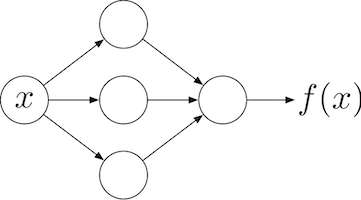

# 第19回 ニューラルネットワークによる回帰と分類

## この回の目標

多層パーセプトロンで回帰と分類のモデルを学習させ，学習曲線から過学習を判断できる。

## 解説

この回では，第17回で扱った PyTorch の学習ループと，第18回で扱った損失関数を使い，ニューラルネットワークで回帰と分類のモデルを学習させる。
スクリプトの先頭には，第17回と同様に次の処理を書く。

```python
import numpy as np
import matplotlib.pyplot as plt
import torch
from torch import nn
from pathlib import Path

figure_dir = Path("outputs/exc19")
figure_dir.mkdir(parents=True, exist_ok=True)
```

以下のコード例は，このコードに続けて書いて実行する。

### 1. 多層パーセプトロン

#### 線形モデルの限界

第17回で扱った `nn.Linear` は，入力 $\boldsymbol{x}$ に対して $\boldsymbol{W}\boldsymbol{x}+\boldsymbol{b}$ を出力する。
このように，入力の線形変換と定数の加算だけで出力を決めるモデルを **線形モデル (linear model)** という。
入力が 1 次元の回帰では，線形モデルの予測はグラフ上で直線になる。
2 クラス分類では，クラス 0 とクラス 1 の出力 $\boldsymbol{w}_0^\top\boldsymbol{x}+b_0$ と $\boldsymbol{w}_1^\top\boldsymbol{x}+b_1$ の大小が入れ替わる境界は，次の式で表される。

$$
(\boldsymbol{w}_1-\boldsymbol{w}_0)^\top\boldsymbol{x}+(b_1-b_0)=0
$$

この境界は，入力が 2 次元なら直線，3 次元以上なら平面である。
このため，線形モデルは曲線的な関係を予測できず，原点を囲む円の内側と外側のようなクラスも分けられない。

#### 活性化関数

線形変換の出力の各要素に非線形な関数を適用すると，線形モデルでは表せない関係を表せるようになる。
このための関数を **活性化関数 (activation function)** という。
代表的な活性化関数を次の表に示す。

| 名前 | 式 | 値の範囲 | PyTorch |
| --- | --- | --- | --- |
| ReLU | $\max(0, z)$ | $[0, \infty)$ | `nn.ReLU()`，`torch.relu` |
| sigmoid | $\dfrac{1}{1+e^{-z}}$ | $(0, 1)$ | `nn.Sigmoid()`，`torch.sigmoid` |
| tanh | $\dfrac{e^{z}-e^{-z}}{e^{z}+e^{-z}}$ | $(-1, 1)$ | `nn.Tanh()`，`torch.tanh` |

sigmoid は第18回で扱った関数である。
ReLU (rectified linear unit) は，計算が簡単で，正の入力に対する導関数の値が 1 で一定であるため，隠れ層（後述）の活性化関数として最もよく使われる。

```python
z = torch.linspace(-4, 4, 161)
fig, ax = plt.subplots()
ax.plot(z, torch.relu(z), label="ReLU")
ax.plot(z, torch.sigmoid(z), label="sigmoid")
ax.plot(z, torch.tanh(z), label="tanh")
ax.set_xlabel("z")
ax.set_ylabel("activation")
ax.legend()
ax.grid(True)
fig.savefig(figure_dir / "session19_example_activations.png")
plt.show()
plt.close(fig)

z = torch.tensor([-2.0, 0.0, 2.0])
print(torch.relu(z))     # tensor([0., 0., 2.])
print(torch.sigmoid(z))  # tensor([0.1192, 0.5000, 0.8808])
print(torch.tanh(z))     # tensor([-0.9640,  0.0000,  0.9640])
```

`torch.relu` などの関数は，tensor の各要素に作用し，同じ shape の tensor を返す。
`requires_grad=True` を指定していない tensor は，NumPy 配列と同様に `ax.plot` に渡せる。
指定した tensor は，`z.detach()` のように `detach()`（第17回）してから渡す。
ReLU のグラフは $z=0$ で折れ曲がり，sigmoid と tanh のグラフは $z$ の絶対値が大きくなると平らになる。

#### 線形変換の合成

活性化関数を挟まずに線形変換を 2 回適用しても，結果は 1 回の線形変換と同じである。

$$
\boldsymbol{W}_2(\boldsymbol{W}_1\boldsymbol{x}+\boldsymbol{b}_1)+\boldsymbol{b}_2
=(\boldsymbol{W}_2\boldsymbol{W}_1)\boldsymbol{x}+(\boldsymbol{W}_2\boldsymbol{b}_1+\boldsymbol{b}_2)
$$

右辺は，重み $\boldsymbol{W}_2\boldsymbol{W}_1$，バイアス $\boldsymbol{W}_2\boldsymbol{b}_1+\boldsymbol{b}_2$ の線形モデルである（第5回の行列積）。
このため，層を重ねて表現力を高めるには，線形変換の間に活性化関数が必要である。

#### 層を重ねたモデル

線形変換と活性化関数を交互に重ねたモデルを **多層パーセプトロン (multilayer perceptron, MLP)** という。
最も簡単な MLP は，線形変換，活性化関数，線形変換をこの順に適用する次のモデルである。

$$
\boldsymbol{h}=\phi(\boldsymbol{W}_1\boldsymbol{x}+\boldsymbol{b}_1),\qquad
\hat{\boldsymbol{y}}=\boldsymbol{W}_2\boldsymbol{h}+\boldsymbol{b}_2
$$

$\phi$ は活性化関数であり，ベクトルの各要素に適用する。
入力 $\boldsymbol{x}$ と出力 $\hat{\boldsymbol{y}}$ の間で計算する $\boldsymbol{h}$ を **隠れ層 (hidden layer)** といい，$\boldsymbol{h}$ の要素数を隠れ層の **ユニット数** という。
次の図は，入力が 1 次元，隠れ層が 3 ユニット，出力が 1 次元の MLP を表す（丸が各ユニット，矢印が重みに対応する）。



入力が $d_{\mathrm{in}}$ 次元，隠れ層が $d_{\mathrm{h}}$ ユニット，出力が $d_{\mathrm{out}}$ 次元のとき，$\boldsymbol{W}_1$ は $d_{\mathrm{h}}\times d_{\mathrm{in}}$ 行列，$\boldsymbol{W}_2$ は $d_{\mathrm{out}}\times d_{\mathrm{h}}$ 行列である。
したがって，パラメータの総数は $d_{\mathrm{h}}d_{\mathrm{in}}+d_{\mathrm{h}}+d_{\mathrm{out}}d_{\mathrm{h}}+d_{\mathrm{out}}$ となる。
隠れ層のユニット数を増やしたり，隠れ層を重ねたりすると，より複雑な関数を表せる。
活性化関数に ReLU を使った MLP の出力は，入力が 1 次元なら折れ線，2 次元なら平面をつないだ形になる。

### 2. PyTorch でのモデル定義

#### nn.Sequential

`nn.Sequential` は，渡した層を前から順に適用するモデルを作る。

```python
torch.manual_seed(0)
model = nn.Sequential(
    nn.Linear(3, 8),
    nn.ReLU(),
    nn.Linear(8, 1),
)
x = torch.zeros(5, 3)
print(model(x).shape)  # torch.Size([5, 1])
print(model)
```

```text
Sequential(
  (0): Linear(in_features=3, out_features=8, bias=True)
  (1): ReLU()
  (2): Linear(in_features=8, out_features=1, bias=True)
)
```

入力の shape は `(サンプル数, 入力の次元)` とし，先頭の軸にサンプルを並べる。
`print(model)` で層の並びを確認できる。
括弧内の番号は層の番号であり，パラメータの名前（`0.weight` など）にも使われる。
`torch.manual_seed(0)` は PyTorch の乱数の初期状態を固定する関数であり，実行するたびに同じパラメータの初期値が得られるようにする。

#### nn.Module を継承したクラス

入力を途中で分岐させたり，層の出力どうしを足したりするモデルは，`nn.Sequential` では書けない。
このような場合は，`nn.Module` を継承したクラスを定義する。
第2回で扱ったクラスの定義で，`class MLP(nn.Module):` のように括弧内に既存のクラスを書くと，そのクラスの属性やメソッドを引き継いだ新しいクラスを定義できる。
これを **継承 (inheritance)** といい，引き継ぐ元のクラスを **親クラス** という。
`nn.Module` を継承したクラスは，パラメータの管理や `model(x)` の形での呼び出しなど，PyTorch のモデルに必要な機能を引き継ぐ。

```python
class MLP(nn.Module):
    def __init__(self, in_features, hidden_features, out_features):
        super().__init__()
        self.fc1 = nn.Linear(in_features, hidden_features)
        self.act = nn.ReLU()
        self.fc2 = nn.Linear(hidden_features, out_features)

    def forward(self, x):
        h = self.act(self.fc1(x))
        return self.fc2(h)

model = MLP(3, 8, 1)
print(model(torch.zeros(5, 3)).shape)  # torch.Size([5, 1])
```

- `class MLP(nn.Module):`：`nn.Module` を親クラスとするクラス `MLP` を定義する。
- `super().__init__()`：親クラス `nn.Module` の初期化を行う。層を属性に代入する前に呼ぶ必要がある。
- `self.fc1 = nn.Linear(...)`：属性に代入した層は，モデルの部品として登録され，`model.parameters()` に含まれる。
- `forward(self, x)`：入力 `x` から出力を計算する処理を書く。
- `model(x)`：`forward` が呼ばれる。`model.forward(x)` と直接呼ばずに，`model(x)` と書く。

#### パラメータ数

`model.named_parameters()` は，パラメータの名前と tensor の組を順に返す。

```python
for name, p in model.named_parameters():
    print(name, tuple(p.shape), p.numel())
print(sum(p.numel() for p in model.parameters()))  # 41
```

```text
fc1.weight (8, 3) 24
fc1.bias (8,) 8
fc2.weight (1, 8) 8
fc2.bias (1,) 1
```

`p.numel()` は tensor の要素数を返す。
`fc1.weight` の shape が `(8, 3)` であるように，`nn.Linear(in_features, out_features)` の重みの shape は `(out_features, in_features)` である（第17回）。
パラメータの総数は $8\times3+8+1\times8+1=41$ であり，第1節の式と一致する。

### 3. 回帰

#### 出力と損失関数

実数値を予測する **回帰 (regression)** では，最後の層の出力の数を予測したい値の数（1 つの値なら 1）とし，活性化関数を付けずにそのまま予測値とする。
損失関数には，第17回と同じ `nn.MSELoss`（平均二乗誤差）を使う。
第18回で見たように，平均二乗誤差の最小化は，誤差が正規分布に従うと仮定した最尤推定にあたる。

#### Adam

この回では，optimizer に **Adam** を使う。
Adam は，勾配 $g_k$ の移動平均 $m_k$ と，勾配の二乗の移動平均 $v_k$ を使い，パラメータ $\theta$ の各要素を次のように更新する。

$$
m_k=\beta_1m_{k-1}+(1-\beta_1)g_k,\qquad
v_k=\beta_2v_{k-1}+(1-\beta_2)g_k^2,\qquad
\theta_{k+1}=\theta_k-\eta\frac{\hat{m}_k}{\sqrt{\hat{v}_k}+\varepsilon}
$$

$\hat{m}_k$，$\hat{v}_k$ は，初期値 $m_0=v_0=0$ の影響を補正した $m_k$，$v_k$ である。
既定値は $\beta_1=0.9$，$\beta_2=0.999$，$\varepsilon=10^{-8}$ である。
$m_k$ は第16回で触れた momentum の役割を持つ。
$\sqrt{\hat{v}_k}$ で割ることで，勾配の大きさが異なるパラメータでも，1 回の更新量がおよそ学習率 $\eta$ 程度にそろう。
このため，Adam は SGD より学習率の選び方に敏感でないことが多い。
PyTorch では，`torch.optim.Adam(model.parameters(), lr=1e-3)` のように使う。
`lr` の既定値は `1e-3` である。

```python
x = torch.linspace(-1, 1, 41).reshape(-1, 1)
y = x**2
print(x.shape, y.shape)  # torch.Size([41, 1]) torch.Size([41, 1])

torch.manual_seed(0)
model = MLP(1, 16, 1)
loss_fn = nn.MSELoss()
optimizer = torch.optim.Adam(model.parameters(), lr=1e-2)
for step in range(500):
    optimizer.zero_grad()
    loss = loss_fn(model(x), y)
    loss.backward()
    optimizer.step()

with torch.no_grad():
    print(loss_fn(model(x), y).item())              # 約 0.0006
    print(loss_fn(model(x), y.reshape(-1)).item())  # 約 0.195（警告が出る）
```

学習ループは第17回と同じであり，optimizer だけが異なる。
この例では，各更新で 41 点すべてを使い，損失は約 0.0006 まで下がる。
`MSELoss` に渡す予測と正解の shape は一致させる。
2 つ目の `print` のように，予測の shape が `(41, 1)`，正解の shape が `(41,)` だと，ブロードキャスト（第3回）で shape `(41, 41)` の差が計算され，誤った損失になる。
このとき PyTorch は警告を出すが，計算は止まらない。

### 4. 分類

#### logits と CrossEntropyLoss

クラスを予測する **分類 (classification)** では，クラス数を $C$ とし，最後の層の出力の数を $C$ とする。
この $C$ 個の出力は，第18回で扱ったクラスごとのスコア（logits）である。
損失関数には `nn.CrossEntropyLoss` を使う。
`nn.CrossEntropyLoss` は内部で softmax を計算するので，モデルの最後に softmax を入れない。
logits は shape `(N, C)` の浮動小数点数，正解は shape `(N,)` の整数（`torch.int64`）のクラス番号とする（第18回）。

#### 予測クラスと正解率

予測クラスは logits が最大となるクラスの番号であり，`logits.argmax(dim=1)` で求める。
softmax は各サンプルの logits の大小関係を変えないので，softmax で求めた確率が最大となるクラスと一致する。
予測クラスが正解と一致したサンプルの割合を **正解率 (accuracy)** という。

次の例では，2 つの座標の一方だけが 1 のときにクラス 1 となる 4 点（XOR と呼ばれる）を分類する。
この 4 点は，1 本の直線では 2 つのクラスに分けられない。

```python
x = torch.tensor([[0.0, 0.0], [0.0, 1.0], [1.0, 0.0], [1.0, 1.0]])
y = torch.tensor([0, 1, 1, 0])
print(y.dtype)  # torch.int64

torch.manual_seed(0)
model = MLP(2, 8, 2)
loss_fn = nn.CrossEntropyLoss()
optimizer = torch.optim.Adam(model.parameters(), lr=0.05)
for step in range(300):
    optimizer.zero_grad()
    loss = loss_fn(model(x), y)
    loss.backward()
    optimizer.step()

with torch.no_grad():
    logits = model(x)
pred = logits.argmax(dim=1)
print(logits.shape)                      # torch.Size([4, 2])
print(pred)                              # tensor([0, 1, 1, 0])
print((pred == y).float().mean().item())  # 1.0
```

`torch.tensor` に整数のリストを渡すと，dtype は `torch.int64` になる。
`pred == y` は要素ごとの比較で真偽値の tensor を返し，`.float()` で 0 と 1 に変換して平均をとると正解率になる。
各クラスの確率が必要な場合は，`torch.softmax(logits, dim=1)` で計算する。
同じ設定で線形モデル `nn.Linear(2, 2)` を学習させると，4 点すべてで 2 つの logits がほぼ等しくなり（どちらのクラスの確率もほぼ 0.5），損失は $\log 2\approx0.693$ より小さくならない。
このとき予測クラスは丸め誤差程度のわずかな logits の差で決まるため，正解率は偶然に左右される意味のない値になる。

### 5. 誤差逆伝播法

#### 連鎖律による勾配の計算

学習では，損失 $L$ のすべてのパラメータについての偏微分が必要である。
入力 1 次元，隠れ層 1 ユニット，出力 1 次元の MLP と，正解 $t$ に対する二乗誤差を例に，この計算を考える。

$$
u=w_1x+b_1,\qquad h=\mathrm{ReLU}(u),\qquad \hat{y}=w_2h+b_2,\qquad L=(\hat{y}-t)^2
$$

$L$ は $\hat{y}$ を通して $w_2$，$b_2$，$h$ に依存し，$h$ は $u$ を通して $w_1$，$b_1$ に依存する。
そこで，第4回で扱った連鎖律を出力側から順に使う。

$$
\frac{\partial L}{\partial \hat{y}}=2(\hat{y}-t),\qquad
\frac{\partial L}{\partial w_2}=\frac{\partial L}{\partial \hat{y}}\,h,\qquad
\frac{\partial L}{\partial b_2}=\frac{\partial L}{\partial \hat{y}},\qquad
\frac{\partial L}{\partial h}=\frac{\partial L}{\partial \hat{y}}\,w_2
$$

$$
\frac{\partial L}{\partial u}=\frac{\partial L}{\partial h}\,\mathrm{ReLU}'(u),\qquad
\frac{\partial L}{\partial w_1}=\frac{\partial L}{\partial u}\,x,\qquad
\frac{\partial L}{\partial b_1}=\frac{\partial L}{\partial u}
$$

ReLU の導関数は，$u>0$ で 1，$u<0$ で 0 である。
例えば，$x=2$，$t=1$，$w_1=0.5$，$b_1=0.5$，$w_2=-1$，$b_2=0.5$ のとき，$u=1.5$，$h=1.5$，$\hat{y}=-1$，$L=4$ である。
このとき，$\dfrac{\partial L}{\partial \hat{y}}=-4$，$\dfrac{\partial L}{\partial w_2}=-6$，$\dfrac{\partial L}{\partial b_2}=-4$，$\dfrac{\partial L}{\partial h}=4$，$\dfrac{\partial L}{\partial u}=4$，$\dfrac{\partial L}{\partial w_1}=8$，$\dfrac{\partial L}{\partial b_1}=4$ となる。
同じ値は，第17回の自動微分でも得られる。

```python
x, t = 2.0, 1.0
w1 = torch.tensor(0.5, requires_grad=True)
b1 = torch.tensor(0.5, requires_grad=True)
w2 = torch.tensor(-1.0, requires_grad=True)
b2 = torch.tensor(0.5, requires_grad=True)
u = w1 * x + b1
h = torch.relu(u)
y_hat = w2 * h + b2
loss = (y_hat - t)**2
print(u.item(), h.item(), y_hat.item(), loss.item())  # 1.5 1.5 -1.0 4.0
loss.backward()
print(w1.grad, b1.grad, w2.grad, b2.grad)  # tensor(8.) tensor(4.) tensor(-6.) tensor(-4.)
```

#### 順伝播と逆伝播

入力から $u$，$h$，$\hat{y}$，$L$ の順に値を計算することを **順伝播 (forward propagation)** という。
勾配は，順伝播で求めた値を使い，$\dfrac{\partial L}{\partial \hat{y}}$，$\dfrac{\partial L}{\partial h}$，$\dfrac{\partial L}{\partial u}$ のように出力側から入力側へ順に計算する。
各段階では，1 つ出力側で求めた偏微分を再利用するので，同じ計算を繰り返さずに済む。
このように勾配を出力側から順に求める方法を **誤差逆伝播法 (backpropagation)** という。
層が多くても，ユニットが多くても，計算の考え方は同じである。
PyTorch の `backward()` は，順伝播の計算の過程を記録した計算グラフ（第17回）を出力側からたどって，この計算を自動で行う。

逆伝播では，各層の導関数の値が次々に掛け合わされる。
sigmoid の導関数の値は最大でも $0.25$ なので，sigmoid を活性化関数とする層を重ねると，入力側の層ほど勾配が小さくなりやすい。
この現象を **勾配消失 (vanishing gradient)** という。
ReLU の導関数の値は $u>0$ で 1 なので，勾配消失が起こりにくい。
一方，$u<0$ では導関数の値が 0 になり，そのユニットより入力側には勾配が伝わらない。

### 6. 学習曲線と過学習

#### train と validation の損失

第15回で扱ったように，モデルの良し悪しは，学習に使っていない validation のデータで確かめる。
更新回数（またはエポック数）を横軸，train と validation の損失を縦軸にとったグラフを **学習曲線 (learning curve)** という。
この回の例と演習では各更新で train のすべてのデータを使うので，更新回数とエポック数（第16回）は等しい。

評価では，`model.eval()` でモデルを評価用の状態にし，`torch.no_grad()` の中で損失を計算する。
`model.eval()` と `model.train()` は，dropout や batch normalization のように，学習時と評価時で動作が変わる層の状態を切り替える。
この回のモデルにはこのような層はないが，評価の前に `model.eval()`，学習に戻る前に `model.train()` を呼ぶ習慣を付けておく。
`torch.no_grad()` の中では計算グラフが作られない（第17回）ので，勾配が不要な評価の計算量とメモリを減らせる。

#### 過学習

学習を続けると，train の損失は下がり続けるが，validation の損失はある時点から上がり始めることがある。
この状態を **過学習 (overfitting)** という。
過学習では，モデルが train のデータに含まれるノイズまで再現するように学習し，新しいデータに対する予測が悪くなっている。
過学習は，train のデータが少ないとき，モデルのパラメータが多いとき，学習を長く続けたときに起こりやすい。
train の損失と validation の損失の差が広がり続けることが，過学習を判断する目安となる。

#### early stopping

validation の損失が最小になった時点のパラメータを採用する方法を **early stopping** という。
次の例では，各更新の後で train と validation の損失を記録し，validation の損失が最小値を更新したときのパラメータを保存する。

```python
import copy

rng = np.random.default_rng(0)
x_np = rng.uniform(-1, 1, size=(40, 1))
y_np = x_np**2 + rng.normal(0, 0.1, size=(40, 1))
x_all = torch.tensor(x_np, dtype=torch.float32)
y_all = torch.tensor(y_np, dtype=torch.float32)
x_train, y_train = x_all[:20], y_all[:20]
x_val, y_val = x_all[20:], y_all[20:]
loss_fn = nn.MSELoss()

def evaluate(model, x, y):
    model.eval()
    with torch.no_grad():
        loss = loss_fn(model(x), y).item()
    model.train()
    return loss

torch.manual_seed(0)
model = MLP(1, 64, 1)
optimizer = torch.optim.Adam(model.parameters(), lr=1e-2)
train_history, val_history = [], []
best_loss = float("inf")
for step in range(1000):
    optimizer.zero_grad()
    loss = loss_fn(model(x_train), y_train)
    loss.backward()
    optimizer.step()
    train_history.append(evaluate(model, x_train, y_train))
    val_history.append(evaluate(model, x_val, y_val))
    if val_history[-1] < best_loss:
        best_loss = val_history[-1]
        best_step = step
        best_state = copy.deepcopy(model.state_dict())

model.load_state_dict(best_state)
print(best_loss, val_history[-1])  # 約 0.0132 約 0.0134

fig, ax = plt.subplots()
ax.semilogy(train_history, label="train")
ax.semilogy(val_history, label="validation")
ax.axvline(best_step, color="gray", linestyle="--")
ax.set_xlabel("update")
ax.set_ylabel("MSE")
ax.legend()
ax.grid(True)
fig.savefig(figure_dir / "session19_example_curves.png")
plt.show()
plt.close(fig)
```

`copy` は Python の標準ライブラリである。
`model.state_dict()` は，パラメータの名前と tensor を対応付けた辞書を返す（第23回でファイルへの保存に使う）。
この辞書の tensor はモデルのパラメータとデータを共有している（第3回のビュー）ので，そのまま保存すると，その後の更新で値が変わってしまう。
そこで，`copy.deepcopy` で中身ごと複製してから保存する。
学習後に `model.load_state_dict(best_state)` を呼ぶと，保存したパラメータがモデルに戻る。
`float("inf")` は正の無限大であり，最初の validation の損失で必ず更新されるように初期値として使う。
損失は桁が大きく変わるので，学習曲線は `ax.semilogy` で縦軸を対数にして描くと見やすい。
この例では，validation の損失が最小となる時点と最後の時点で損失の差は小さいが，過学習が起こる条件では差が大きくなる。

## 演習

作業場所・保存先・説明の残し方は [共通手順](README.md#作業場所と保存先) に従ってください。
演習ファイルは，自分の作業リポジトリ（ `~/workspace/signal-ml-work` ）直下の `exercise/` 以下に置いてください。
以下の相対パスは，自分の作業リポジトリを基準とします。
ファイル名は `exc授業回2桁_問題番号2桁.py` の形式に統一してください。第19回の第1問であれば，`exercise/exc19_01.py` とします。
各ファイルの先頭には，解説の冒頭にある `import` 文と，保存先ディレクトリ `figure_dir`（`outputs/exc19`）を作成する処理を書いてください。
図は `figure_dir` に，問題番号を含むファイル名で保存してください。第1問の図であれば，`outputs/exc19/exc19_01.png` とします。1 つの問題で複数の図を保存する場合は，`exc19_04_data.png` のように後ろに名前を付けてください。
NumPy 配列は `torch.tensor(..., dtype=torch.float32)` で tensor に変換してください。ただし，分類の正解ラベルは `dtype=torch.int64` とします。
モデルを作る直前には `torch.manual_seed(0)` を実行してください。複数のモデルを比べるときも，それぞれのモデルを作る直前に実行します。

基本的にはプログラム (Python) を使って取り組むことを想定しています。
ただし，次の 2 種類の指示がある問題は，プログラムを実行する前に自分で考えてください。

- **予想してください**：実行前に結果を予想してコメントに書き，実行後に予想と一致したか，一致しなかった場合はその理由を追記してください。
- **手計算してください**：コンピュータを使わずに計算し，途中の式と答えをコメントに書いてください。そのうえでプログラムで計算した結果と比較してください。

### 基礎レベル（6問）
1. 活性化関数の値と導関数を確かめ，線形変換の間に活性化関数が必要な理由を確認します。

    1. ReLU，sigmoid，tanh の $z=-1, 0, 1$ における値を手計算してください。sigmoid と tanh は，$e^{-1}\approx0.368$，$e^{-2}\approx0.135$ を使って小数第 2 位まで求めてください。また，連鎖律を使って sigmoid の導関数を求め，$z=0$ における値を手計算してください。tanh の導関数は $1-\tanh^2 z$ であることを使って，$z=0$ における値を求めてください。
    2. `exercise/exc19_01.py` で，3 つの活性化関数のそれぞれについて，`z = torch.linspace(-5, 5, 201, requires_grad=True)` を作り直して関数の値を計算し，その和に `backward()` を適用して，`z.grad` から導関数の値を求めてください。上段に関数，下段に導関数を描き，`outputs/exc19/exc19_01.png` に保存してください（描画には `detach()` した tensor を使います）。`z[100]`（$z=0$ に最も近い要素）における関数と導関数の値を表示し，1 の答えと比較してください。また，関数の値の和に `backward()` を適用すると各要素の導関数の値が得られる理由を説明してください。
    3. ReLU は，第4回で扱った $\lvert x\rvert$ と同様に，$z=0$ で微分できません。`torch.tensor(0.0, requires_grad=True)` に対して ReLU の導関数の値を求め，PyTorch がこの点で返す値を確認してください。この点の値をどう決めても学習にほとんど影響しない理由を考察してください。
    4. `torch.manual_seed(0)` の後に `layer1 = nn.Linear(2, 4)`，`layer2 = nn.Linear(4, 1)`，`x = torch.randn(5, 2)` を作り，`layer2(layer1(x))` を計算してください。次に，`W = layer2.weight @ layer1.weight` と `b = layer2.weight @ layer1.bias + layer2.bias` から `x @ W.T + b` を計算し，[`torch.allclose`](https://docs.pytorch.org/docs/stable/generated/torch.allclose.html) で 2 つの結果が一致することを確かめてください。`W` と `b` の shape も表示してください。この結果から，線形変換の間に活性化関数がないと，層を重ねても表せる関数が増えない理由を説明してください。

2. MLP の shape とパラメータ数を確かめます。モデル `nn.Sequential(nn.Linear(2, 16), nn.ReLU(), nn.Linear(16, 3))` を考えます。

    1. 各層の重みとバイアスの shape と，パラメータの総数を手計算してください。また，shape が `(5, 2)` の入力に対する出力の shape を予想してください。
    2. `exercise/exc19_02.py` でこのモデルを作り，`named_parameters()` で各パラメータの名前と shape を，`numel()` でパラメータの総数を表示して，1 の答えと比較してください。shape が `(5, 2)` の入力に対する出力の shape も表示してください。
    3. 同じ構造のモデルを，解説と同様に `nn.Module` を継承したクラス `MLP` として定義してください。`MLP(2, 16, 3)` のパラメータの総数と出力の shape が，2 の結果と一致することを確かめてください。
    4. 隠れ層のユニット数を 64 にした場合のパラメータの総数を手計算し，プログラムで確かめてください。パラメータの総数が隠れ層のユニット数に対してどのように増えるかを，第1節の式を使って説明してください。

3. MLP で回帰を行い，線形モデルと比較します。次のコードでデータを作り，先頭の 70 個を train，残りの 30 個を validation とします。

    ```python
    rng = np.random.default_rng(0)
    x = rng.uniform(0, 1, size=100)
    y = np.sin(2 * np.pi * x) + rng.normal(0, 0.1, size=100)
    ```

    1. 線形モデル `nn.Linear(1, 1)` と MLP `nn.Sequential(nn.Linear(1, 32), nn.ReLU(), nn.Linear(32, 1))` の予測が，それぞれどのような形の曲線になるかを予想してください。また，どちらの validation の平均二乗誤差が小さくなるかを予想してください。
    2. `exercise/exc19_03.py` で，`x` と `y` を shape `(100, 1)` の tensor に変換し，2 つのモデルを `nn.MSELoss` と `torch.optim.Adam(lr=1e-2)` で 2000 回更新してください。各更新では train のすべてのデータを使います。
    3. 2 つのモデルの train と validation の平均二乗誤差を表示してください。また，データ（train と validation は異なる記号）と，`torch.linspace(0, 1, 201)` に対する 2 つのモデルの予測曲線を 1 枚の図に描き，`outputs/exc19/exc19_03.png` に保存してください。予測曲線の計算は `torch.no_grad()` の中で行ってください。
    4. 1 の予想と結果を比較し，線形モデルの誤差が大きい理由を予測曲線の形から説明してください。また，データに加えたノイズの分散が $0.1^2=0.01$ であることから，どのようなモデルでも validation の平均二乗誤差を 0.01 より大きく下回ることはできない理由を説明してください。

4. MLP で 2 クラス分類を行い，学習曲線を描きます。次のコードで，原点を中心とする半径 1 の円の付近（クラス 0）と半径 2 の円の付近（クラス 1）に 200 点ずつ並ぶデータを作り，並べ替えた後の先頭の 280 点（70 %）を train，残りの 120 点を validation とします。

    ```python
    rng = np.random.default_rng(0)
    r = np.concatenate([1 + rng.normal(0, 0.2, size=200), 2 + rng.normal(0, 0.2, size=200)])
    phi = rng.uniform(0, 2 * np.pi, size=400)
    points = np.stack([r * np.cos(phi), r * np.sin(phi)], axis=1)
    labels = np.concatenate([np.zeros(200), np.ones(200)])
    perm = rng.permutation(400)
    points, labels = points[perm], labels[perm]
    ```

    1. `exercise/exc19_04.py` で，クラスごとに色を変えた散布図を描き，`outputs/exc19/exc19_04_data.png` に保存してください。`ax.set_aspect("equal")` で縦軸と横軸の目盛りの間隔をそろえてください。また，train と validation の点の数と，`points` と `labels` から作った tensor の shape と dtype を表示してください。
    2. 線形モデル `nn.Linear(2, 2)` と MLP `nn.Sequential(nn.Linear(2, 16), nn.ReLU(), nn.Linear(16, 2))` のそれぞれについて，validation の正解率を予想してください。
    3. 2 つのモデルを `nn.CrossEntropyLoss` と `torch.optim.Adam(lr=1e-2)` で 200 回更新してください。各更新では train のすべてのデータを使います。更新ごとに train と validation の損失を記録し，4 本の学習曲線を 1 枚の図に描いて `outputs/exc19/exc19_04_curves.png` に保存してください。最後に，2 つのモデルの train と validation の正解率を表示してください。
    4. 2 の予想と結果を比較してください。線形モデルの損失が $\log 2\approx0.693$ 付近までしか下がらない理由を，線形モデルのクラスの境界の形と，第18回の cross-entropy の式から説明してください。
    5. この問題では，最後の層の出力の数を 2 とし，`nn.CrossEntropyLoss` を使いました。基礎第3問の回帰と比べて，出力の数と損失関数が異なる理由を，第18回の内容を使って説明してください。また，正解ラベルを `torch.float32` の tensor として `nn.CrossEntropyLoss` に渡すと何が起きるかを確かめてください（他の処理とは分けて実行してください）。

5. 誤差逆伝播法による勾配の計算を，手計算と自動微分で確かめます。解説の第5節と同じネットワーク $u=w_1x+b_1$，$h=\mathrm{ReLU}(u)$，$\hat{y}=w_2h+b_2$，$L=(\hat{y}-t)^2$ を考え，$x=1.5$，$t=6$，$w_1=2$，$b_1=-1$，$w_2=3$，$b_2=0.5$ とします。

    1. $u$，$h$，$\hat{y}$，$L$ の値を手計算してください。
    2. $\dfrac{\partial L}{\partial \hat{y}}$，$\dfrac{\partial L}{\partial h}$，$\dfrac{\partial L}{\partial u}$ をこの順に手計算し，それらを使って $L$ の $w_1$，$b_1$，$w_2$，$b_2$ についての偏微分を求めてください。どの偏微分を求めるときに，どの偏微分を再利用したかも書いてください。
    3. `exercise/exc19_05.py` で，4 つのパラメータを `requires_grad=True` の tensor として作り，`backward()` で求めた勾配を 2 の答えと比較してください。
    4. $b_1=-4$ に変えると，4 つの勾配のうちどれが 0 になるかを予想してから，プログラムで確かめてください（`-0.` と表示される値も 0 です）。この状態から勾配降下法で更新を続けると $w_1$ と $b_1$ がどうなるかを，ReLU の導関数の値から説明してください。

6. train のデータが少ないときに起こる過学習を，学習曲線から判断します。基礎第3問と同じデータを使い，train を先頭の 10 点だけに減らします（validation は基礎第3問と同じ 30 点です）。モデルは，隠れ層を 2 層（各 256 ユニット）にした MLP `nn.Sequential(nn.Linear(1, 256), nn.ReLU(), nn.Linear(256, 256), nn.ReLU(), nn.Linear(256, 1))` とします。

    1. このモデルのパラメータの総数を手計算し，train のデータ数と比べてください。また，更新を続けると train と validation の平均二乗誤差がそれぞれどう変化するかを予想してください。
    2. `exercise/exc19_06.py` で，`nn.MSELoss` と `torch.optim.Adam(lr=1e-3)` を使ってモデルを 3000 回更新し，各更新の後の train と validation の平均二乗誤差を記録してください。学習曲線を `ax.semilogy` で描き，`outputs/exc19/exc19_06.png` に保存してください。
    3. validation の平均二乗誤差が最小になった更新回数とその値，最後の更新の後の train と validation の平均二乗誤差を表示してください。
    4. 学習曲線のどの部分から過学習が起きていると判断できるかを，train と validation の平均二乗誤差の変化に基づいて説明してください。
    5. 最後の更新の後のモデルの予測曲線を基礎第3問と同様に描き，`outputs/exc19/exc19_06_fit.png` に保存してください。train の 10 点に対する予測曲線の通り方と，基礎第3問の MLP の予測曲線との違いから，過学習したモデルが何を学習しているかを説明してください。

### 発展レベル（3問）
1. 基礎第6問の学習に early stopping を組み込み，その効果と `copy.deepcopy` が必要な理由を確かめます。

    1. `exercise/exc19_07.py` で，基礎第6問と同じデータ，モデル，設定で 3000 回更新し，validation の平均二乗誤差が最小値を更新するたびに，`copy.deepcopy(model.state_dict())` でパラメータを保存してください。学習後，最後のパラメータでの validation の平均二乗誤差を表示してから，保存したパラメータを `load_state_dict` で読み込み，validation の平均二乗誤差を表示して比較してください。
    2. 最後のパラメータと保存したパラメータの予測曲線を，データとともに 1 枚の図に描き，`outputs/exc19/exc19_07.png` に保存してください。2 つの予測曲線が大きく異なる $x$ の範囲を答え，その範囲に train の点があるかどうかと結びつけて説明してください。
    3. `copy.deepcopy` を使わずに `best_state = model.state_dict()` と保存した場合に，学習後の `best_state["0.weight"]` が最後のモデルの `model[0].weight` と一致するかを予想してください。実際にこの方法でも保存し，[`torch.equal`](https://docs.pytorch.org/docs/stable/generated/torch.equal.html) で確かめてください。結果から，`copy.deepcopy` が必要な理由を説明してください。
    4. early stopping では，validation のデータを見て採用するパラメータを決めています。このとき，採用したモデルの validation の平均二乗誤差を「新しいデータに対する誤差」として報告すると，実際より良く見積もる可能性がある理由を，第15回で扱った test のデータの役割と結びつけて説明してください。

2. 基礎第4問の分類で，クラスの境界の形と隠れ層のユニット数の関係を調べます。

    1. `exercise/exc19_08.py` で，基礎第4問と同じ線形モデルと MLP を学習させてください。$-3\le x_1\le3$，$-3\le x_2\le3$ の範囲を各 201 点に分けた格子点を `np.meshgrid`（第16回）で作り，shape `(40401, 2)` の tensor にして，各点の予測クラスを計算してください。`ax.contourf` で予測クラスを塗り分け，データの散布図を重ねて，2 つのモデルを左右に並べた図を `outputs/exc19/exc19_08.png` に保存してください。
    2. 隠れ層のユニット数を 2，3，16 に変えた MLP を，それぞれ `torch.manual_seed(0)`，`torch.manual_seed(1)`，`torch.manual_seed(2)` の 3 通りの初期値から 1000 回更新し，validation の正解率を表にしてください。その他の設定は基礎第4問と同じです。また，`torch.manual_seed(0)` の場合の 3 つのモデルの境界を 1 と同様に描き，`outputs/exc19/exc19_08_hidden.png` に保存してください。
    3. ReLU を使った MLP では，隠れ層のユニット $j$ の出力は，入力の平面上の直線 $\boldsymbol{w}_j^\top\boldsymbol{x}+b_j=0$ の片側で 0，反対側で 1 次関数になります。このため，2 つのクラスの logits の差は，これらの直線で区切られた領域ごとに 1 次関数となり，クラスの境界は線分や半直線をつないだ形になります。このことに着目して，ユニット数が 2 では内側の円を囲む境界を作れない理由を説明してください。
    4. ユニット数が 3 の場合に，初期値によって正解率が大きく異なる理由を，第16回で扱った局所解と初期値の関係と結びつけて考察してください。

3. train のデータ数によって，過学習の程度がどう変わるかを調べます。

    1. 基礎第6問と同じモデルと設定で，train のデータ数を 10，30，70 に変えて，それぞれ 3000 回更新してください。いずれも基礎第3問のデータの先頭から取り，validation は同じ 30 点とします。実行前に，データ数を増やすと最後の train と validation の平均二乗誤差の差がどう変わるかを予想してください。
    2. `exercise/exc19_09.py` で，3 つの条件の validation の平均二乗誤差の最小値，最後の validation の平均二乗誤差，最後の train の平均二乗誤差を表にして表示してください。また，3 つの条件の validation の学習曲線を 1 枚の図に `ax.semilogy` で描き，`outputs/exc19/exc19_09.png` に保存してください。
    3. 1 の予想と結果を比較してください。パラメータの総数（基礎第6問）は 3 つの条件で同じであることに注意して，データ数が増えると過学習が起こりにくくなる理由を，予測曲線が各点のノイズに合わせて曲がる余地と結びつけて説明してください。

## 詰まったときに見る資料
- [`../textbook/markdown/ch23-basics-of-neural-networks.md`](../textbook/markdown/ch23-basics-of-neural-networks.md)：層の計算，目的関数，誤差逆伝播法，勾配消失
- [PyTorch tutorial: Build the Neural Network](https://docs.pytorch.org/tutorials/beginner/basics/buildmodel_tutorial.html)
- [PyTorch docs: torch.nn](https://docs.pytorch.org/docs/stable/nn.html)
